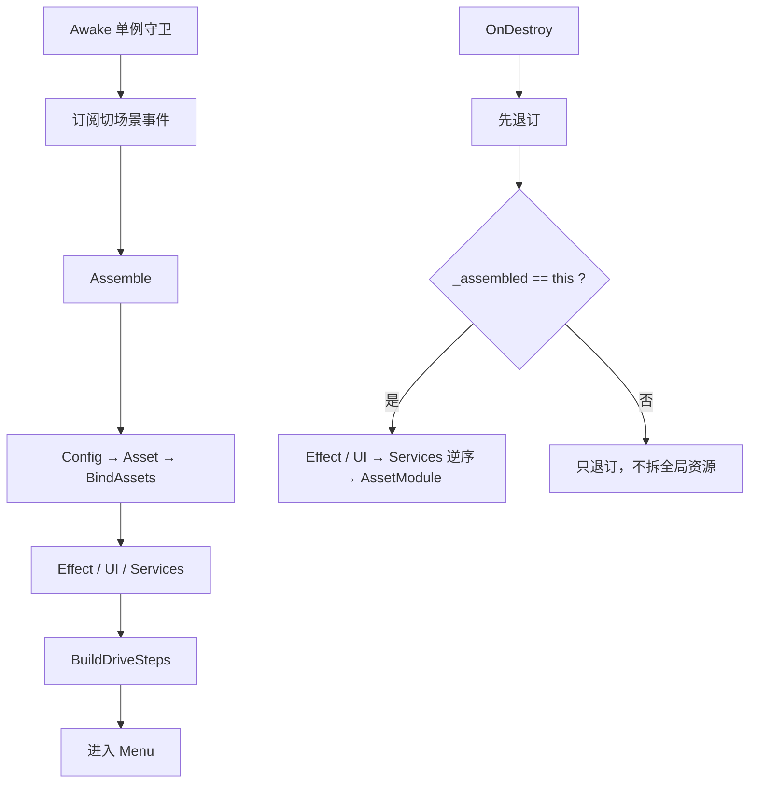
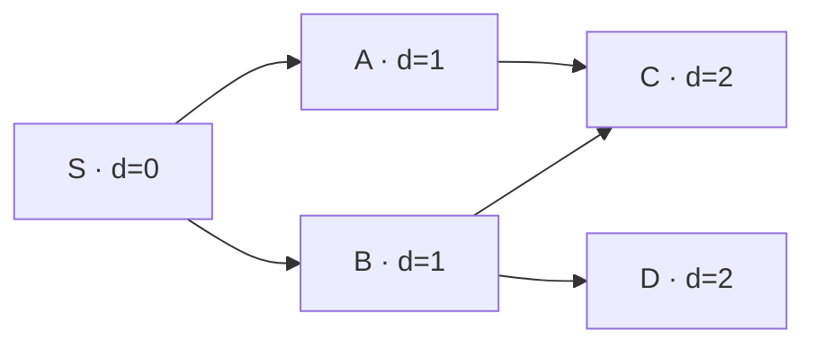

# 教学文风 V2 样稿

> 版本基线：v1.7.0 ｜ 用途：人工检查“结论先行、结构图、真实证据、失效边界”是否真正压住文字噪声。

## 代码机制：GameRoot 的唯一装配轴

`GameRoot` 把进程级对象的创建、每帧驱动和拆解责任集中到一个长期存活的对象上。核心约束是：只有真正完成装配的实例可以拆解，其他实例只能在 `Awake` 阶段退出。



装配与拆解不是对称地从上往下执行；真正对称的是所有权。`_assembled` 把拆解权绑定到执行过 `AssetModule.Init()` 的实例，避免重进场景时新对象清掉仍在使用的全局缓存。

```csharp
protected override void Awake()
{
    base.Awake();

    if (!ReferenceEquals(Instance, this)) return;

    EventBus<RequestLoadScene>.Subscribe(OnRequestChangeScene);

    Assemble();

    IsReady = true;
}
```

删除 `ReferenceEquals` 守卫后，同一帧的两个实例都会执行 `Assemble()`，第二次 `AssetModule.Init()` 会抛异常。删除拆解守卫时症状更隐蔽：切场景后贴图、音效和池化对象突然失效，而装配阶段不一定报错。

## 算法：BFS 为什么第一次到达就是最短路

无权图中，BFS 按距离分层访问顶点。队列前部顶点的距离不会大于后部顶点，因此某个顶点第一次被发现时，当前层数已经是它到起点的最少边数。



以从 `S` 出发为例：

| 步骤 | 弹出 | 新发现 | 队列 |
| --: | :-- | :-- | :-- |
| 1 | `S` | `A, B` | `A, B` |
| 2 | `A` | `C` | `B, C` |
| 3 | `B` | `D` | `C, D` |
| 4 | `C` | 无 | `D` |

`C` 先由 `A` 发现；后来 `B → C` 不会把它覆盖成更远距离。`dist` 数组负责记录首次到达的距离，`visited` 防止同一顶点重复入队。

```python
from collections import deque


def shortest_distances(graph, source):
    dist = {source: 0}
    queue = deque([source])

    while queue:
        u = queue.popleft()
        for v in graph[u]:
            if v in dist:
                continue
            dist[v] = dist[u] + 1
            queue.append(v)

    return dist
```

时间复杂度是 `O(V + E)`，空间复杂度是 `O(V)`。适合无权图；有非负边权时应改用 Dijkstra。非连通图中，未出现在结果里的顶点表示不可达；若题目需要所有连通分量，就要从未访问顶点继续启动 BFS。
