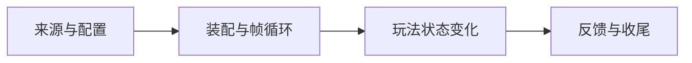

# 课程母图

这份文档先回答课程如何罩住全部内容，再进入具体讲解。它是可编辑 Markdown，不是 PowerPoint。

## 目标能力

- 学完后能够：

## 系统总图



## 完整运行链

| Run | 从什么开始 | 可观察终点 | 本链覆盖 |
| :-- | :-- | :-- | :-- |
| R1 |  |  |  |

## 概念分级

| 级别 | 概念 | 为什么重要 | 首次出现 |
| :-- | :-- | :-- | :-- |
| 主轴必懂 |  |  |  |
| 当前支撑 |  |  |  |
| 实现细节 |  |  |  |
| 以后可查 |  |  |  |

## 课程数据

````markdown
```course-json
{
  "version": 1,
  "courseId": "replace-me",
  "title": "replace-me",
  "outcomes": ["replace-me"],
  "sourceRoots": ["T:/replace-me"],
  "coverage": [],
  "concepts": [],
  "runs": []
}
```
````

## 证据与未解决项

- 源码已核对：
- 测试已覆盖：
- 运行已观察：
- 待验证：
